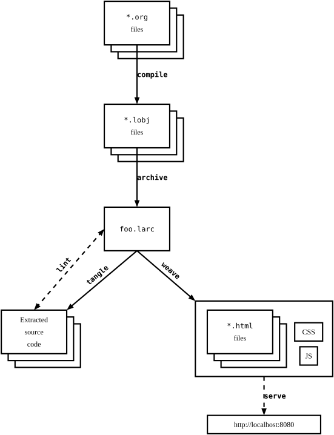

:PROPERTIES:
:ID:       75bea01b-b487-4709-978b-2156f4233ebb
:END:
#+title: User Manual

* Introduction

Lilac originally started out as [[https://github.com/listx/lilac-legacy][an extension to Emacs Orgmode]], to fix
most of the nondeterminism issues of Orgmode's weaving (aka "export") process.

Sometime later, it was determined that Orgmode's HTML export was simply too slow
(it could take 10+ seconds on large documents). This project was then rewritten
in [[https://www.haskell.org/][Haskell]], mainly for performance but also for maintainability.

* Major differences with vanilla Org

This section may be useful for existing Orgmode users, to see at a glance what
is and isn't supported.

Orgmode is quite complex. Some features have been purposely left out, mainly for
simplicity or readability.

** Compilation step
:PROPERTIES:
:ID:       9078b9d4-b331-499c-89f8-4b3a355f3c72
:END:

Orgmode tangles and weaves from Org files directly. There is no intermediate
compilation step.

Lilac adds a compilation step in order to cache some computations. Basically, an
Org doc must be compiled into a Lilac Object (~*.lobj~), and then one or more of
these objects are archived into a Lilac Archive (~*.larc~). It is this archive
file which is then tangled or woven as needed.

#+name: fig:lilac-subcommands
#+caption: The relationship of Lilac subcommands. [[id:58b8cf79-8b0d-4092-a70c-f772fff985b5][~init~]] is not included here because it is not strictly needed.
#+type: figure

#+name: fig:lilac-subcommands.pikchr
#+header: :tangle image/lilac-subcommands.pikchr
#+header: :collapsed true
#+begin_src txt
Org1: box "*.org" mono "files" fill white
Org2: box at Org1.c + (2mm, -2mm) behind Org1 fill white
Org3: box at Org2.c + (2mm, -2mm) behind Org2 fill white

Lobj1: box "*.lobj" mono "files" at Org1.c + (0, -3cm) fill white
Lobj2: box at Lobj1.c + (2mm, -2mm) behind Lobj1 fill white
Lobj3: box at Lobj2.c + (2mm, -2mm) behind Lobj2 fill white

Larc: box "foo.larc" mono at Lobj1.c + (0, -3cm) fill white

Code1: box "Extracted" "source" "code" at Larc + (-3cm, -3cm) fill white
Code2: box at Code1.c + (2mm, -2mm) behind Code1 fill white
Code3: box at Code2.c + (2mm, -2mm) behind Code2 fill white

Html1: box "*.html" mono "files" at Larc + (3cm, -3cm) fill white
Html2: box at Html1.c + (2mm, -2mm) behind Html1 fill white
Html3: box at Html2.c + (2mm, -2mm) behind Html2 fill white
CSS: box "CSS" at Html1.c + (2cm, 0) fit fill white
JS: box "JS" at CSS.c + (0, -0.7cm) fit fill white
StaticAssets: box width 4cm height 2.2cm at Html1.c + (0.7cm, -0.2cm)

Site: box "http://localhost:8080" fit at StaticAssets + (0, -2.5cm) fill white

arrow " compile" mono bold ljust from Org1.s to Lobj1.n
arrow " archive" mono bold ljust from Lobj1.s to Larc.n
arrow "tangle"   mono bold above aligned <- from Code1.ne to Larc.s
arrow "weave"    mono bold above aligned from Larc.s to StaticAssets.nw
arrow " serve"   mono bold ljust dashed from StaticAssets.s to Site.n
arrow "lint"     mono bold above aligned <-> dashed from Code1.n to Larc.w
#+end_src

** List item spacing required

List items /must/ be indented from the main text with two leading spaces, and also
must have an empty blank line. See [[id:58f69993-599d-4389-ba47-3056b1bb2350][List items]].

These spacing requirements were determined to be necessary in order to maximize
readability in raw Org (plaintext) form.

** Noweb links can reference blocks from other files

You can reference code blocks in other files, as long as those files are also
compiled (into objects) and become part of the archive. For example, see
[[id:af82950f-ec4a-46e1-9af5-995222cd35e3::module:Lilac.Types][module:Lilac.Types]] where many of the Noweb links point to blocks in other files.

** No ~#+include~ support

The ability to declaratively copy/paste chunks of other files is not supported,
because doing so results in unreadable raw Org files (you would have to open up
the linked page separately to see what was actually included).

** Headings must be linked via their ID (UUID)

You cannot link to headings by their name, or by a "search" of a file path. You
must instead always use UUID links. See [[id:518106d0-9b79-4221-9a37-13db371c1d48::ti:0004-properties-drawer-not-empty][ti:0004-properties-drawer-not-empty]] for
an example (or, if you are reading this document from the raw Org file, just
grep for ~:ID:~)

By the same token, all documents require a UUID, so that even if you don't have
a heading, other documents can still reference a named code block in your doc
via the top-level document UUID.

You probably don't want to type these ID values by hand. In Emacs, you can use
~M-x org-store-link~ to get the heading or document's ID (or create one
automatically in the process if one doesn't exist yet).

** No implicit concatenation of multiple blocks sharing the same name when tangling

Orgmode allows multiple code blocks all sharing the same ~#+header: :noweb-ref
bar~ metadata, where during tangling these code blocks will be concatenated
together, in the order that they appear in the doc. *However, we do not allow
this style for the following reasons:*

  1) Orgmode doesn't have good navigation support for it.
     ~org-babel-goto-named-src-block~ only supports ~#+name: ...~ metadata.

  2) Using this style can lead to anonymous blocks that don't have a name. IOW,
     avoiding this style forces us to provide a name for all code blocks, and
     naming everything is generally not a bad thing, because explicit is better
     than implicit.

  3) The order of concatenation is implicitly hardcoded to be top-to-bottom.
     When we only use ~#+name: ...~, we can choose any order we want, not just
     top-to-bottom (by naming the children and choosing how to order the
     exposition of these child blocks).

** Expandable code blocks

If you set ~#+header: :collapsed true~ for a code block, it will be collapsed in
the woven output. You can then click on a button to expand it. This is useful
when you have source code that generates figures (drawing), and you don't want
the code to steal the attention away from the figure.
[[fig:lilac-subcommands.pikchr]] is an example of this.

Below is an example of a collapsed anonymous block.

#+header: :collapsed true
#+begin_src txt
Lorem ipsum dolor sit amet.
#+end_src

** Other unsupported Org features

The features below are not supported (and are not planned to be supported).

  - [[https://orgmode.org/manual/Radio-Targets.html][Radio links]]

  - Links to other Org documents by filename. Lilac only supports linking to
    other Org documents by their ID (see [[id:f8254d58-7a3d-4595-a265-e0d6255e6ab5][Links]]).

  - TeX export. Lilac only supports HTML export.

  - Strike-through formatting. Lilac does not support +strike-through+ formatting
    (the ~+~ signs are ignored).

  - Syntax highlighting of code blocks based on the Emacs theme being used (if
    one were to export an Org file to HTML from Emacs). Lilac uses a variation
    of the ~kate~ theme (see [[id:33dc521a-2096-4088-9ccc-e55a2119bbfa][Syntax highlighting theme]]).

* Comparison with other LP tools

#+caption: Comparison of LP tools.
| Name          |  Written in  | Written with LP?\n(Does it use itself?) | Markup language\n(Input syntax) | Tangle-able languages |
|---------------+--------------+-----------------------------------------+---------------------------------+-----------------------|
|               |     <c>      |                   <c>                   |               <c>               |          <c>          |
| [[id:a8d786d5-8522-454b-971d-fa1b46c5aecc][Lilac]]         |   Haskell    |                   Yes                   |             Orgmode             |          Any          |
| [[https://orgmode.org/][Emacs Orgmode]] |  Emacs Lisp  |                   No                    |             Orgmode             |          Any          |
| [[https://github.com/entangled/entangled.py/][Entangled]]     |    Python    |                   No                    |            Markdown             |          Any          |
| [[https://github.com/justinmeiners/srcweave][srcweave]]      | Common Lisp  |                   No                    |            Markdown             |          Any          |
| [[http://www.ross.net/funnelweb/index.shtml][FunnelWeb]]     |      C       |                   No                    |    FunnelWeb [fn:web-markup]    |          Any          |
| [[https://github.com/rixed/portia/blob/master/intro.fw][Portia]]        |    OCaml     |                   Yes                   |               Any               |          Any          |
| [[https://github.com/nrnrnr/noweb][Noweb]]         | C, Awk, Icon |                   Yes                   |      Noweb [fn:web-markup]      |          Any          |
| [[https://nuweb.sourceforge.net/][Nuweb]]         |      C       |                   Yes                   |              LaTeX              |          Any          |
| [[https://github.com/zyedidia/Literate][Literate]]      |      D       |                   Yes                   |            Markdown             |          Any          |
| [[https://github.com/ascherer/cweb][CWEB]]          |      C       |                   Yes                   |       TeX [fn:web-markup]       |        C, C++         |

* Basic initial setup
:PROPERTIES:
:ID:       be668181-6a9f-4dac-8e5a-8dc57fd5a651
:END:

The main requirement is that you must author Org files, because that's what
Lilac understands. Emacs is perhaps the most popular application for authoring
Org files, so using Emacs is highly recommended.

Clone this repo. There are 2 ways to install Lilac. The first is with Nix and
[[https://docs.cachix.org/installation][Cachix]]. You can just download from the ~funloop~ Cachix cache, by running

#+begin_src bash
cachix use funloop
make build-release
make install-release
#+end_src

The ~build-release~ target will end up pulling from the ~funloop~ cache (unless CI
on ~main~ branch is broken).

You can also build with Cabal, by running ~make install~ to have Cabal install the
~lilac~ binary to disk. For end-users, this is not as desirable because it takes
longer.

Now go to your repo where you want to use Lilac. Run

#+begin_src sh
lilac init
#+end_src

to generate a starter ~Lilac.toml~ and ~index.org~. This will also give you a
~Makefile~, which you can use to run ~make~ to start tangling and weaving. You can
also do ~watch -cn 1 make~ to constantly run ~make~ so that you don't have to keep
running it yourself.

At this point your ~index.org~ is your source of truth, so have a read through it,
and adjust as needed.

* Using Lilac as a static site generator

Because Lilac weaves output to HTML, it makes it suitable for use as a static
content generator. An example is https://funloop.org/build.html (source code at
https://git.sr.ht/~listx/personal-website).

There are a couple flags for the ~weave~ subcommand which are worth mentioning for
using Lilac as an SSG:

  - ~--out-dir~ flag
    [[id:21ccfaf6-cd49-46b6-9075-4952f3eea207::(f:weaveOptsHandler-out-dir)]]: Use
    this to put all generated assets to a dedicated subdirectory. If you are
    hosting your site on SourceHut, you'd want to use this option because you
    need to upload a tarball of your static contents (and it's easier to create
    a tarball from a subdirectory that only has static contents).

  - ~--root-relative-prefix~ flag
    [[id:21ccfaf6-cd49-46b6-9075-4952f3eea207::(f:weaveOptsHandler-root-relative-prefix)]]:
    Use this if you don't have control over the server's root folder in
    production. That is, by default Lilac will make every HTML page pull CSS and
    JS from top-level ~css~ and ~js~ folders. However it may be the case that you
    need to pull these from a subdirectory from the root. This subdirectory,
    then, is what you'd specify for this flag.

* Footnotes

[fn:web-markup] For CWEB, it has the ~cweave~ utility which then converts this to
TeX, after which it can be converted as a PDF. However, both FunnelWeb and Noweb
can support any documentation language, not just TeX --- although, you are still
required to use that same documentation language directly in your input file. For
example, Noweb input files with the ~*.nw~ file syntax can be processed by
an HTML backend /if/ you have HTML already inside the ~*.nw~ files. In a sense both
FunnelWeb and Noweb are just text preprocessors --- they have no knowledge of
the underlying documentation syntax (HTML, TeX, or otherwise) used in the input
files.
